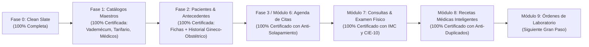

# 📋 Plan de Progreso y Certificación Modular CENDO

> **Proyecto:** CENDO - Centro de Endometriosis y Ginecología  
> **Director Médico:** Dr. Patrick José Jacinto Gomero (CMP 61693 | RNE 38657)  
> **Arquitectura:** Rebanadas Verticales por Dominio (*Vertical Slice / Feature Modules*)  
> **Meta:** Cero archivos gigantes (> 1,000 líneas), código modular aislado (< 120 líneas por archivo), validación anti-duplicados en 3 capas y persistencia 100% en la nube Supabase.

---

## 🧭 Metodología de Trabajo: Enfoque *Bottom-Up*
1. **Catálogos Base** &rarr; 2. **Directorio de Pacientes** &rarr; 3. **Actos Médicos Transaccionales** &rarr; 4. **Alta Especialidad** &rarr; 5. **Exportación y Certificación Multi-Dispositivo**.

Cada módulo contendrá su propio cuarteto estándar:
- `modulo.types.ts`: Tipos TypeScript específicos.
- `modulo.validator.ts`: Esquemas Zod y detección de duplicados previa a la red.
- `modulo.service.ts`: CRUD contra Supabase con manejo seguro de errores.
- `components/`: Modales y vistas del módulo.

---

## 📊 Estado General de Fases y Módulos

---

## 🗂️ Detalle Exhaustivo por Módulos y Checklists

### 🧹 FASE 0: Tabula Rasa & Infraestructura de Sincronización
- [x] Crear script maestro de vaciado `supabase/clean_slate_reset.sql` (`TRUNCATE CASCADE` de las 16 tablas sin tocar `public.profiles`).
- [x] Garantizar persistencia y accesos de los 3 médicos oficiales con clave `Cendo123`.
- [x] Actualizar `fetchAllDataFromSupabase` para soportar estados vacíos (`[]`) sin forzar datos quemados obsoletos.
- [x] Implementar script de certificación automatizada `scripts/test-vademecum-crud.mjs`.
- [x] Ejecutar y validar test automatizado del Vademécum (4/4 pruebas PASS, 100% de éxito).
- [x] Crear script opcional de carga de fármacos ginecológicos oficiales `scripts/seed-vademecum.mjs`.

---

### 📦 FASE 1: Catálogos Maestros (Sin dependencias externas)

#### 💊 Módulo 1: Vademécum Farmacológico (`src/modules/vademecum/`)
- [x] **Estructura Modular:**
  - [x] `src/modules/vademecum/vademecum.types.ts`: Tipos dedicados de fármacos, marcas y precios.
  - [x] `src/modules/vademecum/vademecum.validator.ts`:
    - [x] Detección preventiva de fármaco duplicado por nombre genérico (insensible a mayúsculas/espacios).
    - [x] Detección preventiva de colisión de código ATC.
    - [x] Validación de marcas comerciales con precio de referencia > 0.
  - [x] `src/modules/vademecum/vademecum.service.ts`:
    - [x] `fetchVademecum()`: Consulta en vivo de fármacos.
    - [x] `createMedication()`: Creación con validación y upsert en Supabase.
    - [x] `updateMedication()`: Edición de marcas, posología e indicaciones.
    - [x] `deleteMedication()`: Eliminación segura.
- [x] **Base de Datos (Supabase):**
  - [x] Índice único case-insensitive en PostgreSQL: `CREATE UNIQUE INDEX IF NOT EXISTS idx_vademecum_unique_name ON public.medications_vademecum (LOWER(TRIM(generic_name)));`
- [x] **Interfaz Gráfica (`/vademecum`):**
  - [x] Alerta interactiva amigable en `VademecumModal` si el doctor escribe un nombre que ya existe, invitándolo a editar o agregar una nueva marca comercial.
  - [x] Empty state visual limpio cuando la tabla está vacía.
- [x] **Certificación:**
  - [x] Ejecutar `npm run test:vademecum` y certificar creación, lectura, edición y eliminación (4/4 PASS, 100%).
  - [x] Build de producción Next.js 14 exitoso (14/14 rutas generadas con 0 errores).

---

#### 🏷️ Módulo 2: Tarifario Institucional y Procedimientos (`src/modules/tarifario/`)
- [x] **Estructura Modular:**
  - [x] `src/modules/tarifario/tarifario.types.ts`: Tipos de tarifas, categorías (Consulta, Ecografía, Procedimiento, Paquete) y precios.
  - [x] `src/modules/tarifario/tarifario.validator.ts`:
    - [x] Validación de código único (ej. `PROC-001`).
    - [x] Detección de nombre de procedimiento duplicado.
    - [x] Precio obligatorio y mayor a 0 PEN.
  - [x] `src/modules/tarifario/tarifario.service.ts`:
    - [x] `fetchTariff()`: Consulta en vivo de tarifas.
    - [x] `createTariffItem()`: Creación con validación en Supabase.
    - [x] `updateTariffItem()`: Edición de precio, descripción y estado activo.
    - [x] `deleteTariffItem()`: Eliminación segura.
- [x] **Base de Datos (Supabase):**
  - [x] Garantizar índice único en `procedures_tariff (code)` y `procedures_tariff (LOWER(TRIM(name)))`.
- [x] **Interfaz Gráfica (`/tarifario`):**
  - [x] Conexión de `/tarifario` y `TariffModal` al nuevo servicio y validador modular.
  - [x] Mensaje de prevención de código o procedimiento repetido.
- [x] **Certificación:**
  - [x] Script automatizado `scripts/test-tarifario-crud.mjs` (`npm run test:tarifario`) con 4/4 PASS (100%).
  - [x] Inyección de 10 tarifas oficiales CENDO con `npm run seed:tarifario`.
  - [x] Build de producción Next.js 14 verificado (14/14 rutas con 0 errores).

---

#### 👨‍⚕️ Módulo 3: Directorio Médico, Roles y Accesos (`src/modules/usuarios/`)
- [x] **Estructura Modular:**
  - [x] `src/modules/usuarios/usuarios.types.ts`: Perfil médico, roles (`director`, `doctor`, `assistant`), credenciales CMP/RNE.
  - [x] `src/modules/usuarios/usuarios.validator.ts`:
    - [x] Correo institucional único y con formato válido.
    - [x] CMP numérico y validación de RNE.
    - [x] Detección preventiva de cuenta duplicada por correo o CMP.
  - [x] `src/modules/usuarios/usuarios.service.ts`:
    - [x] `fetchDoctors()`: Carga de lista médica de `public.profiles`.
    - [x] `createDoctor()`: Alta de especialista y generación de bienvenida.
    - [x] `updateDoctorProfile()`: Edición de CMP, RNE, especialidad y firma.
    - [x] `updateDoctorPassword()`: Actualización directa de contraseña en la nube.
    - [x] `deleteDoctor()`: Eliminación segura con protección de cuenta del Director Médico.
- [x] **Base de Datos (Supabase):**
  - [x] Índice único condicional en PostgreSQL para `public.profiles (cmp)`.
- [x] **Interfaz Gráfica (`/usuarios`):**
  - [x] Conexión de `/usuarios` y `DoctorModal` al validador y servicio modular.
- [x] **Certificación:**
  - [x] Script automatizado `scripts/test-usuarios-crud.mjs` (`npm run test:usuarios`) con 4/4 PASS (100%).
  - [x] Verificación de los 3 médicos oficiales (Dr. Patrick, Dr. Carlos, Dra. Andrea).
  - [x] Build de producción Next.js 14 verificado (14/14 rutas con 0 errores).

---

### 🏥 FASE 2: Núcleo de Pacientes e Historia Patronímica

#### 👤 Módulo 4: Directorio de Pacientes (`src/modules/pacientes/`)
- [x] **Estructura Modular:**
  - [x] `src/modules/pacientes/pacientes.types.ts`: Ficha patronímica del paciente (`Patient`, `CreatePatientInput`, `UpdatePatientInput`).
  - [x] `src/modules/pacientes/pacientes.validator.ts`:
    - [x] Validación de DNI peruano (8 a 12 caracteres, alfanumérico).
    - [x] Detección preventiva de DNI duplicado antes de enviar (`checkDuplicatePatient`).
    - [x] Cálculo automático de edad cronológica según fecha de nacimiento (`calculateAge`).
  - [x] `src/modules/pacientes/pacientes.service.ts`:
    - [x] `fetchPatients()`: Consulta ordenada por fecha de registro en Supabase.
    - [x] `fetchPatientById()`: Búsqueda unificada por UUID o por DNI.
    - [x] `createPatient()`: Creación con mayúsculas estándar y persistencia.
    - [x] `updatePatient()`: Modificación de teléfono, correo, estado civil y ocupación.
    - [x] `deletePatient()`: Borrado seguro en la nube.
- [x] **Base de Datos (Supabase):**
  - [x] Garantizar índice único `idx_patients_dni` en `public.patients (dni)`.
- [x] **Interfaz Gráfica (`/pacientes`):**
  - [x] Conexión de `/pacientes` y `PatientModal` al nuevo servicio y validador modular.
  - [x] Alerta de prevención de DNI duplicado para preservar trazabilidad legal.
- [x] **Certificación:**
  - [x] Script automatizado `scripts/test-pacientes-crud.mjs` (`npm run test:pacientes`) con 4/4 PASS (100%).
  - [x] Inyección de las 5 pacientes oficiales con `npm run seed:pacientes`.
  - [x] Build de producción Next.js 14 verificado (14/14 rutas con 0 errores).

---

#### 📜 Módulo 5: Antecedentes Gineco-Obstétricos (`src/modules/antecedentes/`)
- [x] **Estructura Modular:**
  - [x] `src/modules/antecedentes/antecedentes.types.ts`: Menarquia, FUR, R/C (ej. 28/4), Fórmula Obstétrica (G_ P____), ITS, alergias, patologías familiares.
  - [x] `src/modules/antecedentes/antecedentes.validator.ts`:
    - [x] Validación de formato de fecha FUR (`YYYY-MM-DD`).
    - [x] Calculadora de semanas y días de amenorrea obstétrica (`calculateGestationalAgeFromFur`).
    - [x] Catálogo unificado de métodos anticonceptivos (`STANDARD_CONTRACEPTIVE_OPTIONS`).
  - [x] `src/modules/antecedentes/antecedentes.service.ts`:
    - [x] `fetchBackgroundByPatientId()`: Consulta directa por UUID del paciente.
    - [x] `saveBackground()`: Upsert seguro en `public.patient_backgrounds` con constraint `patient_id`.
    - [x] `deleteBackgroundByPatientId()`: Eliminación limpia.
- [x] **Base de Datos (Supabase):**
  - [x] Índice único `uq_patient_backgrounds_patient_id` en `public.patient_backgrounds (patient_id)`.
- [x] **Interfaz Gráfica:**
  - [x] Conexión de `PatientBackgroundModal` al nuevo servicio y validador modular.
- [x] **Certificación:**
  - [x] Script automatizado `scripts/test-antecedentes-crud.mjs` (`npm run test:antecedentes`) con 4/4 PASS (100%).
  - [x] Inyección de los antecedentes clínicos de las 5 pacientes oficiales con `npm run seed:antecedentes`.
  - [x] Build de producción Next.js 14 verificado (14/14 rutas con 0 errores).

---

### 🩺 FASE 3: El Acto Médico Transaccional

#### 📅 Módulo 6: Agenda de Citas Médicas (`src/modules/agenda/`)
- [x] **Estructura Modular:**
  - [x] `src/modules/agenda/agenda.types.ts`: `MedicalAppointment`, `AppointmentStatus`, `AppointmentType`, `CreateAppointmentInput`.
  - [x] `src/modules/agenda/agenda.validator.ts`:
    - [x] Validación Zod de fecha `YYYY-MM-DD`, hora `HH:mm` y duración.
    - [x] Prevención y detección matemática de solapamiento de horario por especialista (`checkScheduleConflict`).
    - [x] Validación de estados clínicos (Pendiente, Confirmada, En Espera, Atendida, Cancelada, No Asistió).
  - [x] `src/modules/agenda/agenda.service.ts`:
    - [x] `fetchAppointmentsFromSupabase()`: Lectura en vivo ordenada por fecha y hora con join a datos de paciente.
    - [x] `saveAppointmentToSupabase()`: Creación/edición segura con validación previa de colisión de turnos.
    - [x] `deleteAppointmentFromSupabase()`: Cancelación y borrado seguro en la nube.
- [x] **Base de Datos (Supabase):**
  - [x] Tabla `public.medical_appointments` vinculada con clave foránea a `public.patients(id)`.
- [x] **Interfaz Gráfica (`/agenda`):**
  - [x] Integración de `AppointmentModal` con validación y alerta preventiva SweetAlert2 ante cruce de turnos.
  - [x] Dashboard de la agenda con métricas KPI (Confirmadas, En Espera, Atendidas).
- [x] **Certificación:**
  - [x] Script automatizado `scripts/test-agenda-crud.mjs` (`npm run test:agenda`) con 4/4 PASS (100%).
  - [x] Inyección de 5 citas clínicas oficiales con `npm run seed:agenda`.
  - [x] Build de producción Next.js 14 verificado (14/14 rutas con 0 errores).

#### 🩺 Módulo 7: Consulta Ginecológica Estructurada (`src/modules/consultas/`)
- [x] **Estructura Modular:**
  - [x] `src/modules/consultas/consultas.types.ts`: `MedicalConsultation`, `ConsultationVitalSigns`, `ConsultationPhysicalExam`, `CreateConsultationInput`.
  - [x] `src/modules/consultas/consultas.validator.ts`:
    - [x] Calculadora dinámica y clasificación clínica de IMC (`calculateBmi`, `classifyBmi`).
    - [x] Validación Zod de presión arterial sistólica/diastólica y signos vitales.
    - [x] Catálogo maestro de diagnósticos frecuentes con códigos CIE-10 ginecológicos (`FREQUENT_DIAGNOSES`).
  - [x] `src/modules/consultas/consultas.service.ts`:
    - [x] `fetchConsultationsFromSupabase()`: Lectura de atenciones con filtrado por paciente.
    - [x] `saveConsultationToSupabase()`: Upsert en `public.medical_consultations` con campos clínicos JSONB.
    - [x] `deleteConsultationFromSupabase()`: Borrado seguro en la nube.
- [x] **Base de Datos (Supabase):**
  - [x] Tabla `public.medical_consultations` con soporte nativo JSONB para signos vitales y examen físico.
- [x] **Interfaz Gráfica:**
  - [x] Integración de `ConsultationModal` con cálculo automático de IMC y validación clínica modular.
- [x] **Certificación:**
  - [x] Script automatizado `scripts/test-consultas-crud.mjs` (`npm run test:consultas`) con 4/4 PASS (100%).
  - [x] Inyección de 5 consultas clínicas estructuradas oficiales con `npm run seed:consultas`.
  - [x] Build de producción Next.js 14 verificado (14/14 rutas con 0 errores).

#### 💊 Módulo 8: Recetario Médico Inteligente (`src/modules/recetas/`)
- [x] **Estructura Modular:**
  - [x] `src/modules/recetas/recetas.types.ts`: `MedicalPrescription`, `PrescriptionItem`, `PrescriptionRoute`, `ClinicalDosagePreset`.
  - [x] `src/modules/recetas/recetas.validator.ts`:
    - [x] Validación Zod de fármaco, posología, vía de administración y duración.
    - [x] Prevención y detección de fármaco duplicado en la misma receta (`checkDuplicateMedicationInPrescription`).
    - [x] Catálogo de plantillas clínicas de dosificación ginecológica en 1 clic (`CLINICAL_DOSAGE_PRESETS`).
  - [x] `src/modules/recetas/recetas.service.ts`:
    - [x] `fetchPrescriptionsFromSupabase()`: Lectura de recetas estructuradas por paciente.
    - [x] `savePrescriptionToSupabase()`: Upsert en `public.medical_prescriptions` con array JSONB de medicamentos.
    - [x] `deletePrescriptionFromSupabase()`: Borrado seguro en la nube.
- [x] **Base de Datos (Supabase):**
  - [x] Tabla `public.medical_prescriptions` con columna `items JSONB` y vínculo de integridad a `public.patients(id)`.
- [x] **Interfaz Gráfica:**
  - [x] Integración de `PrescriptionModal` con autocompletado desde Vademécum, alerta de fármaco repetido y envío por WhatsApp.
- [x] **Certificación:**
  - [x] Script automatizado `scripts/test-recetas-crud.mjs` (`npm run test:recetas`) con 4/4 PASS (100%).
  - [x] Inyección de 5 recetas médicas clínicas oficiales con `npm run seed:recetas`.
  - [x] Build de producción Next.js 14 verificado (14/14 rutas con 0 errores).

#### 🧪 Módulo 9: Órdenes de Laboratorio y Cotizaciones (`src/modules/laboratorio/` & `src/modules/cotizaciones/`)
- [ ] Integración con el Tarifario de la Fase 1.
- [ ] Cálculo de cotizaciones con descuentos y formato WhatsApp para la paciente.
- [ ] Solicitud de exámenes auxiliares (PAP, VPH, CA-125, perfil hormonal).

---

### 🔬 FASE 4: Módulos de Alta Especialidad Ginecológica

#### 🔬 Módulo 10: Colposcopía IFCPC 2011 (`src/modules/colposcopia/`)
- [ ] Mapeo cervical con criterios IFCPC (Unión escamocolumnar, zona de transformación, acetoblanco grado 1 y 2, Schiller).
- [ ] Registro de reloj horario de biopsia cervical (1 a 12 horas).
- [ ] Persistencia en `public.colposcopy_reports`.

#### 📺 Módulo 11: Ecografías Ginecológicas y Obstétricas (`src/modules/ecografias/`)
- [ ] Formatos especializados para Ecografía Transvaginal, Pélvica, Mama Bilateral (BI-RADS 1-5) y Obstétrica.
- [ ] Persistencia en `public.ultrasound_reports`.

#### ✂️ Módulo 12: Procedimientos Menores & Biopsias LEEP (`src/modules/procedimientos/`)
- [ ] Reporte operatorio de cono LEEP, polipectomía, inserción/retiro de DIU o implante Jadelle.
- [ ] Registro de patología, sangrado y hemostasia (Solución de Monsel).
- [ ] Persistencia en `public.minor_procedures`.

#### 👶 Módulo 13: Carnet de Control Prenatal MINSA / CLAP (`src/modules/prenatal/`)
- [ ] Registro de datos basales, cálculo de Naegele / FPP, visitas de control gestacional (1 a 9).
- [ ] Persistencia en `public.prenatal_cards`.

#### 📁 Módulo 14: Repositorio Documental (.pdf & .docx) (`src/modules/documentos/`)
- [ ] Subida a Supabase Storage (bucket `lab-reports`).
- [ ] Registro en `patient_documents` y visualización en modal.

---

### 🚀 FASE 5: Desacoplamiento de la Gran Ficha y Certificación Final
- [ ] **Desacoplar `pacientes/[id]/page.tsx`** (~2,450 líneas) en sub-pestañas autónomas (`TabHistoria`, `TabConsultas`, `TabColposcopia`, `TabEcografias`, `TabRecetas`, etc.).
- [ ] **Aligerar `useMedicalStore.ts`** y eliminar el archivo monolítico `supabaseSync.ts`.
- [ ] Verificación cruzada final en **PC (escritorio)**, **Tablet (iPad/Android)** y **Móvil**.
- [ ] Prueba de aceptación completa con el **Dr. Patrick Jacinto Gomero**.

---

*Última actualización de progreso: 2026-11-14T11:25:00-05:00*
