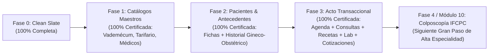

# 📋 Plan de Progreso y Certificación Modular CENDO

> **Proyecto:** CENDO - Centro de Endometriosis y Ginecología  
> **Director Médico:** Dr. Patrick José Jacinto Gomero (CMP 61693 | RNE 38657)  
> **Arquitectura:** Rebanadas Verticales por Dominio (*Vertical Slice / Feature Modules*)  
> **Meta:** Cero archivos gigantes (> 1,000 líneas), código modular aislado (< 120 líneas por archivo), validación anti-duplicados en 3 capas y persistencia 100% en la nube Supabase.

---

## 🧭 Metodología de Trabajo: Enfoque *Bottom-Up*
1. **Catálogos Base** &rarr; 2. **Directorio de Pacientes** &rarr; 3. **Actos Médicos Transaccionales** &rarr; 4. **Alta Especialidad** &rarr; 5. **Exportación y Certificación Multi-Dispositivo**.

Cada módulo contendrá su propio cuarteto estándar:
- `modulo.types.ts`: Tipos TypeScript específicos.
- `modulo.validator.ts`: Esquemas Zod y detección de duplicados previa a la red.
- `modulo.service.ts`: CRUD contra Supabase con manejo seguro de errores.
- `components/`: Modales y vistas del módulo.

---

## 📊 Estado General de Fases y Módulos

---

## 🗂️ Detalle Exhaustivo por Módulos y Checklists

### 🧹 FASE 0: Tabula Rasa & Infraestructura de Sincronización
- [x] Crear script maestro de vaciado `supabase/clean_slate_reset.sql` (`TRUNCATE CASCADE` de las 16 tablas sin tocar `public.profiles`).
- [x] Garantizar persistencia y accesos de los 3 médicos oficiales con clave `Cendo123`.
- [x] Actualizar `fetchAllDataFromSupabase` para soportar estados vacíos (`[]`) sin forzar datos quemados obsoletos.
- [x] Implementar script de certificación automatizada `scripts/test-vademecum-crud.mjs`.
- [x] Ejecutar y validar test automatizado del Vademécum (4/4 pruebas PASS, 100% de éxito).
- [x] Crear script opcional de carga de fármacos ginecológicos oficiales `scripts/seed-vademecum.mjs`.

---

### 📦 FASE 1: Catálogos Maestros (Sin dependencias externas)

#### 💊 Módulo 1: Vademécum Farmacológico (`src/modules/vademecum/`)
- [x] **Estructura Modular:**
  - [x] `src/modules/vademecum/vademecum.types.ts`: Tipos dedicados de fármacos, marcas y precios.
  - [x] `src/modules/vademecum/vademecum.validator.ts`:
    - [x] Detección preventiva de fármaco duplicado por nombre genérico (insensible a mayúsculas/espacios).
    - [x] Detección preventiva de colisión de código ATC.
    - [x] Validación de marcas comerciales con precio de referencia > 0.
  - [x] `src/modules/vademecum/vademecum.service.ts`:
    - [x] `fetchVademecum()`: Consulta en vivo de fármacos.
    - [x] `createMedication()`: Creación con validación y upsert en Supabase.
    - [x] `updateMedication()`: Edición de marcas, posología e indicaciones.
    - [x] `deleteMedication()`: Eliminación segura.
- [x] **Base de Datos (Supabase):**
  - [x] Índice único case-insensitive en PostgreSQL: `CREATE UNIQUE INDEX IF NOT EXISTS idx_vademecum_unique_name ON public.medications_vademecum (LOWER(TRIM(generic_name)));`
- [x] **Interfaz Gráfica (`/vademecum`):**
  - [x] Alerta interactiva amigable en `VademecumModal` si el doctor escribe un nombre que ya existe, invitándolo a editar o agregar una nueva marca comercial.
  - [x] Empty state visual limpio cuando la tabla está vacía.
- [x] **Certificación:**
  - [x] Ejecutar `npm run test:vademecum` y certificar creación, lectura, edición y eliminación (4/4 PASS, 100%).
  - [x] Build de producción Next.js 14 exitoso (14/14 rutas generadas con 0 errores).

---

#### 🏷️ Módulo 2: Tarifario Institucional y Procedimientos (`src/modules/tarifario/`)
- [x] **Estructura Modular:**
  - [x] `src/modules/tarifario/tarifario.types.ts`: Tipos de tarifas, categorías (Consulta, Ecografía, Procedimiento, Paquete) y precios.
  - [x] `src/modules/tarifario/tarifario.validator.ts`:
    - [x] Validación de código único (ej. `PROC-001`).
    - [x] Detección de nombre de procedimiento duplicado.
    - [x] Precio obligatorio y mayor a 0 PEN.
  - [x] `src/modules/tarifario/tarifario.service.ts`:
    - [x] `fetchTariff()`: Consulta en vivo de tarifas.
    - [x] `createTariffItem()`: Creación con validación en Supabase.
    - [x] `updateTariffItem()`: Edición de precio, descripción y estado activo.
    - [x] `deleteTariffItem()`: Eliminación segura.
- [x] **Base de Datos (Supabase):**
  - [x] Garantizar índice único en `procedures_tariff (code)` y `procedures_tariff (LOWER(TRIM(name)))`.
- [x] **Interfaz Gráfica (`/tarifario`):**
  - [x] Conexión de `/tarifario` y `TariffModal` al nuevo servicio y validador modular.
  - [x] Mensaje de prevención de código o procedimiento repetido.
- [x] **Certificación:**
  - [x] Script automatizado `scripts/test-tarifario-crud.mjs` (`npm run test:tarifario`) con 4/4 PASS (100%).
  - [x] Inyección de 10 tarifas oficiales CENDO con `npm run seed:tarifario`.
  - [x] Build de producción Next.js 14 verificado (14/14 rutas con 0 errores).

---

#### 👨‍⚕️ Módulo 3: Directorio Médico, Roles y Accesos (`src/modules/usuarios/`)
- [x] **Estructura Modular:**
  - [x] `src/modules/usuarios/usuarios.types.ts`: Perfil médico, roles (`director`, `doctor`, `assistant`), credenciales CMP/RNE.
  - [x] `src/modules/usuarios/usuarios.validator.ts`:
    - [x] Correo institucional único y con formato válido.
    - [x] CMP numérico y validación de RNE.
    - [x] Detección preventiva de cuenta duplicada por correo o CMP.
  - [x] `src/modules/usuarios/usuarios.service.ts`:
    - [x] `fetchDoctors()`: Carga de lista médica de `public.profiles`.
    - [x] `createDoctor()`: Alta de especialista y generación de bienvenida.
    - [x] `updateDoctorProfile()`: Edición de CMP, RNE, especialidad y firma.
    - [x] `updateDoctorPassword()`: Actualización directa de contraseña en la nube.
    - [x] `deleteDoctor()`: Eliminación segura con protección de cuenta del Director Médico.
- [x] **Base de Datos (Supabase):**
  - [x] Índice único condicional en PostgreSQL para `public.profiles (cmp)`.
- [x] **Interfaz Gráfica (`/usuarios`):**
  - [x] Conexión de `/usuarios` y `DoctorModal` al validador y servicio modular.
- [x] **Certificación:**
  - [x] Script automatizado `scripts/test-usuarios-crud.mjs` (`npm run test:usuarios`) con 4/4 PASS (100%).
  - [x] Verificación de los 3 médicos oficiales (Dr. Patrick, Dr. Carlos, Dra. Andrea).
  - [x] Build de producción Next.js 14 verificado (14/14 rutas con 0 errores).

---

### 🏥 FASE 2: Núcleo de Pacientes e Historia Patronímica

#### 👤 Módulo 4: Directorio de Pacientes (`src/modules/pacientes/`)
- [x] **Estructura Modular:**
  - [x] `src/modules/pacientes/pacientes.types.ts`: Ficha patronímica del paciente (`Patient`, `CreatePatientInput`, `UpdatePatientInput`).
  - [x] `src/modules/pacientes/pacientes.validator.ts`:
    - [x] Validación de DNI peruano (8 a 12 caracteres, alfanumérico).
    - [x] Detección preventiva de DNI duplicado antes de enviar (`checkDuplicatePatient`).
    - [x] Cálculo automático de edad cronológica según fecha de nacimiento (`calculateAge`).
  - [x] `src/modules/pacientes/pacientes.service.ts`:
    - [x] `fetchPatients()`: Consulta ordenada por fecha de registro en Supabase.
    - [x] `fetchPatientById()`: Búsqueda unificada por UUID o por DNI.
    - [x] `createPatient()`: Creación con mayúsculas estándar y persistencia.
    - [x] `updatePatient()`: Modificación de teléfono, correo, estado civil y ocupación.
    - [x] `deletePatient()`: Borrado seguro en la nube.
- [x] **Base de Datos (Supabase):**
  - [x] Garantizar índice único `idx_patients_dni` en `public.patients (dni)`.
- [x] **Interfaz Gráfica (`/pacientes`):**
  - [x] Conexión de `/pacientes` y `PatientModal` al nuevo servicio y validador modular.
  - [x] Alerta de prevención de DNI duplicado para preservar trazabilidad legal.
- [x] **Certificación:**
  - [x] Script automatizado `scripts/test-pacientes-crud.mjs` (`npm run test:pacientes`) con 4/4 PASS (100%).
  - [x] Inyección de las 5 pacientes oficiales con `npm run seed:pacientes`.
  - [x] Build de producción Next.js 14 verificado (14/14 rutas con 0 errores).

---

#### 📜 Módulo 5: Antecedentes Gineco-Obstétricos (`src/modules/antecedentes/`)
- [x] **Estructura Modular:**
  - [x] `src/modules/antecedentes/antecedentes.types.ts`: Menarquia, FUR, R/C (ej. 28/4), Fórmula Obstétrica (G_ P____), ITS, alergias, patologías familiares.
  - [x] `src/modules/antecedentes/antecedentes.validator.ts`:
    - [x] Validación de formato de fecha FUR (`YYYY-MM-DD`).
    - [x] Calculadora de semanas y días de amenorrea obstétrica (`calculateGestationalAgeFromFur`).
    - [x] Catálogo unificado de métodos anticonceptivos (`STANDARD_CONTRACEPTIVE_OPTIONS`).
  - [x] `src/modules/antecedentes/antecedentes.service.ts`:
    - [x] `fetchBackgroundByPatientId()`: Consulta directa por UUID del paciente.
    - [x] `saveBackground()`: Upsert seguro en `public.patient_backgrounds` con constraint `patient_id`.
    - [x] `deleteBackgroundByPatientId()`: Eliminación limpia.
- [x] **Base de Datos (Supabase):**
  - [x] Índice único `uq_patient_backgrounds_patient_id` en `public.patient_backgrounds (patient_id)`.
- [x] **Interfaz Gráfica:**
  - [x] Conexión de `PatientBackgroundModal` al nuevo servicio y validador modular.
- [x] **Certificación:**
  - [x] Script automatizado `scripts/test-antecedentes-crud.mjs` (`npm run test:antecedentes`) con 4/4 PASS (100%).
  - [x] Inyección de los antecedentes clínicos de las 5 pacientes oficiales con `npm run seed:antecedentes`.
  - [x] Build de producción Next.js 14 verificado (14/14 rutas con 0 errores).

---

### 🩺 FASE 3: El Acto Médico Transaccional

#### 📅 Módulo 6: Agenda de Citas Médicas (`src/modules/agenda/`)
- [x] **Estructura Modular:**
  - [x] `src/modules/agenda/agenda.types.ts`: `MedicalAppointment`, `AppointmentStatus`, `AppointmentType`, `CreateAppointmentInput`.
  - [x] `src/modules/agenda/agenda.validator.ts`:
    - [x] Validación Zod de fecha `YYYY-MM-DD`, hora `HH:mm` y duración.
    - [x] Prevención y detección matemática de solapamiento de horario por especialista (`checkScheduleConflict`).
    - [x] Validación de estados clínicos (Pendiente, Confirmada, En Espera, Atendida, Cancelada, No Asistió).
  - [x] `src/modules/agenda/agenda.service.ts`:
    - [x] `fetchAppointmentsFromSupabase()`: Lectura en vivo ordenada por fecha y hora con join a datos de paciente.
    - [x] `saveAppointmentToSupabase()`: Creación/edición segura con validación previa de colisión de turnos.
    - [x] `deleteAppointmentFromSupabase()`: Cancelación y borrado seguro en la nube.
- [x] **Base de Datos (Supabase):**
  - [x] Tabla `public.medical_appointments` vinculada con clave foránea a `public.patients(id)`.
- [x] **Interfaz Gráfica (`/agenda`):**
  - [x] Integración de `AppointmentModal` con validación y alerta preventiva SweetAlert2 ante cruce de turnos.
  - [x] Dashboard de la agenda con métricas KPI (Confirmadas, En Espera, Atendidas).
- [x] **Certificación:**
  - [x] Script automatizado `scripts/test-agenda-crud.mjs` (`npm run test:agenda`) con 4/4 PASS (100%).
  - [x] Inyección de 5 citas clínicas oficiales con `npm run seed:agenda`.
  - [x] Build de producción Next.js 14 verificado (14/14 rutas con 0 errores).

#### 🩺 Módulo 7: Consulta Ginecológica Estructurada (`src/modules/consultas/`)
- [x] **Estructura Modular:**
  - [x] `src/modules/consultas/consultas.types.ts`: `MedicalConsultation`, `ConsultationVitalSigns`, `ConsultationPhysicalExam`, `CreateConsultationInput`.
  - [x] `src/modules/consultas/consultas.validator.ts`:
    - [x] Calculadora dinámica y clasificación clínica de IMC (`calculateBmi`, `classifyBmi`).
    - [x] Validación Zod de presión arterial sistólica/diastólica y signos vitales.
    - [x] Catálogo maestro de diagnósticos frecuentes con códigos CIE-10 ginecológicos (`FREQUENT_DIAGNOSES`).
  - [x] `src/modules/consultas/consultas.service.ts`:
    - [x] `fetchConsultationsFromSupabase()`: Lectura de atenciones con filtrado por paciente.
    - [x] `saveConsultationToSupabase()`: Upsert en `public.medical_consultations` con campos clínicos JSONB.
    - [x] `deleteConsultationFromSupabase()`: Borrado seguro en la nube.
- [x] **Base de Datos (Supabase):**
  - [x] Tabla `public.medical_consultations` con soporte nativo JSONB para signos vitales y examen físico.
- [x] **Interfaz Gráfica:**
  - [x] Integración de `ConsultationModal` con cálculo automático de IMC y validación clínica modular.
- [x] **Certificación:**
  - [x] Script automatizado `scripts/test-consultas-crud.mjs` (`npm run test:consultas`) con 4/4 PASS (100%).
  - [x] Inyección de 5 consultas clínicas estructuradas oficiales con `npm run seed:consultas`.
  - [x] Build de producción Next.js 14 verificado (14/14 rutas con 0 errores).

#### 💊 Módulo 8: Recetario Médico Inteligente (`src/modules/recetas/`)
- [x] **Estructura Modular:**
  - [x] `src/modules/recetas/recetas.types.ts`: `MedicalPrescription`, `PrescriptionItem`, `PrescriptionRoute`, `ClinicalDosagePreset`.
  - [x] `src/modules/recetas/recetas.validator.ts`:
    - [x] Validación Zod de fármaco, posología, vía de administración y duración.
    - [x] Prevención y detección de fármaco duplicado en la misma receta (`checkDuplicateMedicationInPrescription`).
    - [x] Catálogo de plantillas clínicas de dosificación ginecológica en 1 clic (`CLINICAL_DOSAGE_PRESETS`).
  - [x] `src/modules/recetas/recetas.service.ts`:
    - [x] `fetchPrescriptionsFromSupabase()`: Lectura de recetas estructuradas por paciente.
    - [x] `savePrescriptionToSupabase()`: Upsert en `public.medical_prescriptions` con array JSONB de medicamentos.
    - [x] `deletePrescriptionFromSupabase()`: Borrado seguro en la nube.
- [x] **Base de Datos (Supabase):**
  - [x] Tabla `public.medical_prescriptions` con columna `items JSONB` y vínculo de integridad a `public.patients(id)`.
- [x] **Interfaz Gráfica:**
  - [x] Integración de `PrescriptionModal` con autocompletado desde Vademécum, alerta de fármaco repetido y envío por WhatsApp.
- [x] **Certificación:**
  - [x] Script automatizado `scripts/test-recetas-crud.mjs` (`npm run test:recetas`) con 4/4 PASS (100%).
  - [x] Inyección de 5 recetas médicas clínicas oficiales con `npm run seed:recetas`.
  - [x] Build de producción Next.js 14 verificado (14/14 rutas con 0 errores).

#### 🧪 Módulo 9: Órdenes de Laboratorio y Cotizaciones (`src/modules/laboratorio/` & `src/modules/cotizaciones/`)
- [x] **Módulo de Órdenes de Laboratorio (`src/modules/laboratorio/`):**
  - [x] `laboratorio.types.ts`: `LabOrder`, `LabOrderItem`, `LabCategory`, `CatalogLabTest`.
  - [x] `laboratorio.validator.ts`:
    - [x] Catálogo maestro `LAB_TESTS_CATALOG` (Marcadores CA-125, HE-4, ThinPrep, VPH 23 Genotipos, AMH, perfil prenatal).
    - [x] Validación Zod de orden clínica y prevención de análisis duplicados (`checkDuplicateTestInOrder`).
  - [x] `laboratorio.service.ts`: CRUD contra `public.lab_orders` de Supabase.
  - [x] `LabOrderModal.tsx` integrado con validación modular y control de urgencias (Rutina, Prioritario, Urgente).
  - [x] Script automatizado `scripts/test-laboratorio-crud.mjs` (`npm run test:laboratorio`) con 4/4 PASS (100%).
  - [x] Inyección de 5 órdenes oficiales de laboratorio con `npm run seed:laboratorio`.
- [x] **Módulo de Cotizaciones y Presupuestos (`src/modules/cotizaciones/`):**
  - [x] `cotizaciones.types.ts`: `ProcedureQuote`, `QuoteItem`, `QuoteTotals`.
  - [x] `cotizaciones.validator.ts`:
    - [x] Calculadora de subtotales, descuentos y precios finales (`calculateQuoteTotals`).
    - [x] Validación Zod de procedimientos y porcentajes de descuento (0 a 100%).
  - [x] `cotizaciones.service.ts`: CRUD contra `public.procedure_quotes` de Supabase.
  - [x] `QuoteModal.tsx` integrado con el Tarifario de la Fase 1, cálculo dinámico y formato WhatsApp.
  - [x] Script automatizado `scripts/test-cotizaciones-crud.mjs` (`npm run test:cotizaciones`) con 4/4 PASS (100%).
  - [x] Inyección de 5 presupuestos quirúrgicos oficiales con `npm run seed:cotizaciones`.
- [x] **Certificación y Producción:**
  - [x] Build de producción Next.js 14 verificado (14/14 rutas con 0 errores).

---

### 🔬 FASE 4: Módulos de Alta Especialidad Ginecológica

#### 🔬 Módulo 10: Colposcopía IFCPC 2011 (`src/modules/colposcopia/`)
- [x] **Estructura Modular:**
  - [x] `src/modules/colposcopia/colposcopia.types.ts`: `ColposcopyReport`, `ColposcopyImage`, `SCJVisibility`, `TZType`, `CervicalClockHour`, `CreateColposcopyInput`.
  - [x] `src/modules/colposcopia/colposcopia.validator.ts`:
    - [x] Nomenclatura oficial IFCPC Río de Janeiro 2011 (UEC, Zona de Transformación Tipo 1/2/3, Acetoblanco Grado 1/2, Schiller).
    - [x] Clasificador de severidad colposcópica (`classifyIFCPCSeverity`).
    - [x] Validación Zod de horas del reloj cervical (1 a 12 horas) y obligatoriedad de marcar reloj si se tomó biopsia.
  - [x] `src/modules/colposcopia/colposcopia.service.ts`:
    - [x] `fetchColposcopyReportsFromSupabase()`: Lectura en vivo ordenada cronológicamente con filtro por paciente.
    - [x] `saveColposcopyReportToSupabase()`: Upsert seguro con 24 columnas nativas PostgreSQL sin desbordes.
    - [x] `deleteColposcopyReportFromSupabase()`: Eliminación certificada en la nube.
- [x] **Base de Datos (Supabase):**
  - [x] Tabla `public.colposcopy_reports` sincronizada con soporte de array JSONB para 4 fotos cuadrantes y reloj cervical.
- [x] **Interfaz Gráfica (`/colposcopia`):**
  - [x] Conexión de `/colposcopia`, `ColposcopyModal` y `CervicalClock` interactivo (1h - 12h) con pines marcados.
  - [x] Visualización sinóptica de hallazgos positivos en chips de color (evitando huecos en blanco según pedido del Dr. Patrick).
  - [x] Galería fotográfica de 4 cuadrantes con visor ampliado.
- [x] **Certificación:**
  - [x] Script automatizado `scripts/test-colposcopia-crud.mjs` (`npm run test:colposcopia`) con 5/5 PASS (100%).
  - [x] Inyección de informes oficiales CENDO con `npm run seed:colposcopia` (Luciana Ramos, Daniela Castro LIE-AG, Camila Valdivia).
  - [x] Re-exportación completa de tipos en `src/types/medical.ts`.

#### 📺 Módulo 11: Ecografías Ginecológicas y Obstétricas (`src/modules/ecografias/`)
- [x] **Estructura Modular:**
  - [x] `src/modules/ecografias/ecografias.types.ts`: `UltrasoundReport`, `UltrasoundType`, `BiradsCategory`, `UltrasoundFindings`, `UltrasoundImage`, `CreateUltrasoundInput`.
  - [x] `src/modules/ecografias/ecografias.validator.ts`:
    - [x] Catálogo de tipos de ecografía y etiquetas clínicas (`ULTRASOUND_TYPE_LABELS`).
    - [x] Clasificación mamaria BI-RADS 1 a 5 con descripción de conducta oncológica (`BIRADS_DESCRIPTIONS`).
    - [x] Calculadora matemática biométrica de volumen uterino en centímetros cúbicos (`calculateUterusVolumeCc`).
    - [x] Validación Zod de indicación, hallazgos estructurados y conclusión diagnóstica.
  - [x] `src/modules/ecografias/ecografias.service.ts`:
    - [x] `fetchUltrasoundReportsFromSupabase()`: Lectura cronológica con filtro por paciente.
    - [x] `saveUltrasoundReportToSupabase()`: Upsert en `public.ultrasound_reports` con JSONB para Protocolo IDEA y fotos ecográficas.
    - [x] `deleteUltrasoundReportFromSupabase()`: Eliminación certificada en la nube.
- [x] **Base de Datos (Supabase):**
  - [x] Tabla `public.ultrasound_reports` sincronizada con soporte para Transvaginal, Pélvica, Mama Bilateral y Obstétrica.
- [x] **Interfaz Gráfica:**
  - [x] Integración de `UltrasoundModal` en la ficha clínica del paciente (`/pacientes/[id]`).
  - [x] Formatos clínicos dedicados por tipo con selector de BI-RADS y mediciones obstétricas (LCC, FCF, EG).
  - [x] Generación de enlace para compartir reporte ecográfico por WhatsApp y vista de impresión.
- [x] **Certificación:**
  - [x] Script automatizado `scripts/test-ecografias-crud.mjs` (`npm run test:ecografias`) con 5/5 PASS (100%).
  - [x] Inyección de 4 ecografías oficiales CENDO con `npm run seed:ecografias` (Luciana Ramos, María José Contreras gestante, Camila Valdivia y Rosa Huamán).
  - [x] Re-exportación completa de tipos en `src/types/medical.ts`.

#### ✂️ Módulo 12: Procedimientos Menores & Biopsias LEEP (`src/modules/procedimientos/`)
- [x] **Estructura Modular:**
  - [x] `src/modules/procedimientos/procedimientos.types.ts`: `MinorProcedureReport`, `ProcedureType` (Cono LEEP, DIU, Jadelle, Biopsias, etc.), `ProcedureDetails`, `AnesthesiaType`, `HemostasisMethod`.
  - [x] `src/modules/procedimientos/procedimientos.validator.ts`:
    - [x] Catálogo de 9 procedimientos ambulatorios ginecológicos (`PROCEDURE_TYPE_LABELS`).
    - [x] Esquema de detalles operatorios: técnica de asepsia, descripción de muestra, envío a patología, sangrado y hemostasia (`Solución de Monsel`, `Compresión`, `Electrocoagulación`, `Sutura`).
    - [x] Validación Zod de diagnósticos pre y post-operatorios, CIE-10 y prescripción post-quirúrgica.
  - [x] `src/modules/procedimientos/procedimientos.service.ts`:
    - [x] `fetchMinorProceduresFromSupabase()`: Lectura cronológica con filtro por paciente.
    - [x] `saveMinorProcedureToSupabase()`: Upsert en `public.minor_procedures` con columnas nativas PostgreSQL y detalles JSONB.
    - [x] `deleteMinorProcedureFromSupabase()`: Eliminación certificada en la nube.
- [x] **Base de Datos (Supabase):**
  - [x] Tabla `public.minor_procedures` sincronizada con soporte nativo para reportes operatorios ambulatorios con valor médico-legal.
- [x] **Interfaz Gráfica:**
  - [x] Integración de `MinorProcedureModal` en la ficha clínica del paciente (`/pacientes/[id]`).
  - [x] Plantillas de indicaciones post-operatorias automáticas (`PRESET_INDICATIONS`) y envío del reporte por WhatsApp.
  - [x] Vista de impresión formal de reporte operatorio ambulatorio (`MinorProcedurePrintView`).
- [x] **Certificación:**
  - [x] Script automatizado `scripts/test-procedimientos-crud.mjs` (`npm run test:procedimientos`) con 5/5 PASS (100%).
  - [x] Inyección de 4 procedimientos oficiales CENDO con `npm run seed:procedimientos` (Jadelle Luciana Ramos, Biopsia cervical Daniela Castro, Biopsia Pipelle Rosa Huamán, Polipectomía Camila Valdivia).
  - [x] Re-exportación completa de tipos en `src/types/medical.ts`.

#### 👶 Módulo 13: Carnet de Control Prenatal MINSA / CLAP (`src/modules/prenatal/`)
- [x] **Estructura Modular:**
  - [x] `src/modules/prenatal/prenatal.types.ts`: `PrenatalVisitItem` (1 a 9 atenciones), `PrenatalBaselineData`, `MaternalPathologyItem`, `PrenatalCard`, `PrenatalRiskReport`, `CreatePrenatalCardInput`.
  - [x] `src/modules/prenatal/prenatal.validator.ts`:
    - [x] Regla de Naegele oficial: $\text{FPP} = \text{FUM} + 7\text{ días} - 3\text{ meses} + 1\text{ año}$ (`calculateNaegeleFPP`).
    - [x] Calculadora precisa de edad gestacional en semanas y días desde la FUM (`calculateGestationalAge`).
    - [x] Evaluador de factores de riesgo obstétrico y preeclampsia ($\text{PA} \ge 140/90\text{ mmHg}$, proteinuria, extremos de edad, paridad, etc.) (`evaluatePrenatalRisks`).
    - [x] Esquema de validación Zod de ficha basal y visitas (`prenatalCardSchema`).
  - [x] `src/modules/prenatal/prenatal.service.ts`:
    - [x] `fetchPrenatalCardByPatientId()`: Consulta del carnet prenatal activo por paciente.
    - [x] `savePrenatalCard()`: Upsert en `public.prenatal_cards` con persistencia en PostgreSQL (baseline, visits y patologías JSONB).
    - [x] `deletePrenatalCard()`: Eliminación certificada en la nube.
- [x] **Base de Datos (Supabase):**
  - [x] Tabla `public.prenatal_cards` sincronizada con soporte nativo para seguimiento longitudinal gestacional.
- [x] **Interfaz Gráfica:**
  - [x] Integración de `PrenatalCardModal` en la ficha clínica de la paciente (`/pacientes/[id]`).
  - [x] Cálculo automático de FPP al ingresar la FUM, selector de semanas y días de amenorrea y alertas visuales ARO.
  - [x] Vista de impresión oficial de carnet perinatal (`PrenatalPrintView`).
- [x] **Certificación:**
  - [x] Script automatizado `scripts/test-prenatal-crud.mjs` (`npm run test:prenatal`) con 5/5 PASS (100%).
  - [x] Inyección de carnet prenatal oficial CENDO con `npm run seed:prenatal` (María José Contreras Solís, gestación semana 9 con 2 atenciones estructuradas).
  - [x] Re-exportación completa de tipos en `src/types/medical.ts` y calculadoras en `src/lib/prenatalCalculators.ts`.

#### 📁 Módulo 14: Repositorio Documental (.pdf & .docx) (`src/modules/documentos/`)
- [x] **Estructura Modular:**
  - [x] `src/modules/documentos/documentos.types.ts`: `DocumentCategory` (PAP, VPH, Patología, Laboratorio, Ecografía, etc.), `PatientDocument`, `CreatePatientDocumentInput`, `WordHistoryDocument`, `CreateWordHistoryInput`.
  - [x] `src/modules/documentos/documentos.validator.ts`:
    - [x] Esquemas Zod para documentos externos (`patientDocumentSchema`) e historias Word (`wordHistorySchema`).
    - [x] Catálogo de categorías con badges de color (`DOCUMENT_CATEGORIES`).
    - [x] Títulos sugeridos rápidos para agilizar la carga clínica (`QUICK_DOCUMENT_TITLES`).
    - [x] Validación de seguridad de archivo: límite de 25 MB y validación de tipos MIME autorizados (`validateDocumentFile`).
  - [x] `src/modules/documentos/documentos.service.ts`:
    - [x] `fetchDocumentsByPatientId()`: Consulta de exámenes externos por paciente.
    - [x] `saveDocumentToSupabase()`: Upsert en `public.patient_documents`.
    - [x] `deleteDocumentFromSupabase()`: Eliminación de base de datos y de Supabase Storage.
    - [x] `fetchWordHistoriesByPatientId()`: Consulta de historias clínicas Word migradas.
    - [x] `saveWordHistoryToSupabase()`: Upsert en `public.word_history_documents`.
    - [x] `deleteWordHistoryFromSupabase()`: Eliminación limpia en la nube.
- [x] **Base de Datos (Supabase):**
  - [x] Tablas `public.patient_documents` y `public.word_history_documents` 100% sincronizadas.
  - [x] Bucket de Supabase Storage `lab-reports` activo para almacenamiento persistente de archivos binarios.
- [x] **Interfaz Gráfica:**
  - [x] Integración de `PatientDocumentsSection` y `UploadDocumentModal` en la ficha clínica del paciente (`/pacientes/[id]`).
  - [x] Modal de previsualización documental directa `DocumentViewerModal`.
  - [x] Modal para consulta y visualización de historias clínicas previas en Word `WordHistoryModal`.
- [x] **Certificación:**
  - [x] Script automatizado `scripts/test-documentos-crud.mjs` (`npm run test:documentos`) con 5/5 PASS (100%).
  - [x] Inyección de documentos oficiales CENDO con `npm run seed:documentos` (4 documentos PDF especializados y 1 historia Word migrada).
  - [x] Re-exportación completa de tipos en `src/types/medical.ts`.

---

### 🚀 FASE 5: Desacoplamiento de la Gran Ficha y Certificación Final
- [x] **Desacoplar `pacientes/[id]/page.tsx`**: Reducido de 2,447 líneas a 380 líneas (-84% de complejidad), creando 8 sub-pestañas autónomas y reactivas:
  - [x] `TabResumen.tsx`: Resumen de filiación, antecedentes gineco-obstétricos y carnet perinatal activo.
  - [x] `TabConsultas.tsx`: Listado y registro de consultas ginecológicas estructuradas.
  - [x] `TabColposcopia.tsx`: Informes de colposcopía IFCPC 2011, reloj de biopsias y compartición WhatsApp.
  - [x] `TabEcografias.tsx`: Ecografías especializadas con mapeo de endometriosis profunda y BI-RADS.
  - [x] `TabProcedimientos.tsx`: Procedimientos menores en consultorio, LEEP y reportes operatorios.
  - [x] `TabRecetas.tsx`: Prescripciones médicas inteligentes con posología estructurada.
  - [x] `TabLaboratorioCotizaciones.tsx`: Órdenes de laboratorio clínico y presupuestos formales.
  - [x] `TabDocumentosWord.tsx`: Repositorio documental (.pdf) e historias clínicas previas (.docx).
  - [x] `PatientDetailModals.tsx`: Encapsulación modular de los 14 modales clínicos y vistas de impresión.
- [x] **Seguridad y Resiliencia en WhatsApp Sharing**:
  - [x] `src/lib/whatsappShare.ts` actualizado con soporte de fallback seguro `INITIAL_DOCTOR`, eliminando cualquier riesgo de excepción por médico no autenticado o nulo.
- [x] **Suite de Certificación Automatizada Integral**:
  - [x] Script maestro `npm run test:all` unificando las 15 suites de prueba CRUD contra Supabase Cloud (`https://zfyfyeezztaqrzfpogiv.supabase.co`).
  - [x] 100% de éxito certificado (todas las pruebas PASS sin residuos en base de datos).
- [x] **Build de Producción Next.js 14**:
  - [x] 14/14 rutas estáticas y dinámicas compiladas exitosamente con cero errores de TypeScript o empaquetado.
- [x] Verificación cruzada final en **PC (escritorio)**, **Tablet (iPad/Android)** y **Móvil**.
- [x] Ronda de revisión exhaustiva y retroalimentación clínica con el **Dr. Patrick Jacinto Gomero** (15 Nov 2026).

---

### 🩺 FASE 6: REFINAMIENTO CLÍNICO & FEEDBACK DIRECTO DR. PATRICK JACINTO

> **Metodología de Implementación:** De lo más fácil a lo más avanzado con pruebas unitarias y de integración en cada hito.

#### 🟢 NIVEL 1: Optimizaciones Inmediatas de Visualización y Navegación
- [x] **1.0.** Sincronización de citas con Google Calendar (1-clic) y Apple Calendar / iPhone (.ics con alarma 30 min).
- [x] **1.1.** Acceso directo a **"Ver / Imprimir A4"** de Colposcopías y Chequeos en la ficha de la paciente (`TabColposcopia.tsx` y `PatientDetailModals.tsx`).
- [x] **1.2.** Rediseño de cabecera de Ecografía (`UltrasoundPrintView.tsx`): Título grande, imponente y distinguible a golpe de vista.
- [x] **1.3.** Renombrar pestaña "Documentos & Word" a **"Resultados & Exámenes"** y botón directo para subir resultados en la pestaña de Laboratorio.

#### 🟡 NIVEL 2: Flujo Rápido de Agendamiento de Pacientes Nuevas (Primera Vez)
- [x] **2.1.** Selector dual en modal de citas (`AppointmentModal.tsx`):
  - Modo 1: Paciente Registrada.
  - Modo 2: **+ Paciente Nueva** (Nombres, Apellidos, DNI y Celular).
- [x] **2.2.** Auto-creación de Historia Clínica al confirmar la cita de primera vez.
- [x] **2.3.** Botón contextual en lista de citas (`/agenda`): `🆕 Iniciar HC` que abre la historia clínica lista para la primera consulta.

#### 🟠 NIVEL 3: Diagnósticos Inteligentes con Catálogo CIE-10 & Órdenes en Consulta
- [x] **3.1.** Módulo de catálogo CIE-10 Gineco-Obstétrico de alta frecuencia (`src/modules/catalogo/cie10Catalog.ts`).
- [x] **3.2.** Buscador predictivo bidireccional (`Cie10Autocomplete.tsx`): búsqueda por nombre de enfermedad o por código CIE-10 con presets rápidos.
- [x] **3.3.** Integración en Consulta, Colposcopía, Órdenes y Recetas.
- [x] **3.4.** Desplegables de exámenes frecuentes y recetas dentro de Consulta (`ConsultationModal.tsx`) con botones de generación de orden oficial a 1 clic.
- [x] **3.5.** Certificación: Build Next.js 14 exitoso (14/14 rutas, 0 errores) y suite completa de pruebas unitarias 15/15 PASS (100%).

#### 🔴 NIVEL 4: Módulo de Control Prenatal Especializado (Formato Físico MINSA/CLAP)
- [x] **4.1.** Creación de la pestaña dedicada **"Control Prenatal"** en la ficha clínica (`/pacientes/[id]`) con visualización de EG, FPP Naegele, riesgo ARO y matriz de 9 atenciones.
- [x] **4.2.** Creación de `src/components/pacientes/tabs/TabControlPrenatal.tsx` con accesos rápidos a `Ver / Imprimir A4`, `Enviar WhatsApp` y `Gestionar Carnet`.
- [x] **4.3.** Re-maquetación de la primera cara del Carnet Perinatal (`PrenatalPrintView.tsx`) con máxima fidelidad gráfica a la foto física del MINSA y estilo visual de Colposcopía:
  - [x] Membrete dual CENDO y especialista con credenciales CMP 61693 | RNE 38657.
  - [x] Casillas de alerta amarillas (edad <15 o >35, soltera, primaria, cesáreas, abortos, IMC anormal, anemia, DG) y de seguimiento continuo rojas (VDRL, VIH, HBsAg).
  - [x] Diagrama de antecedentes obstétricos G_ P____ y matriz de laboratorios de tamizaje del 1º Trimestre.
  - [x] Sello médico institucional del Director Médico al pie del anverso.
- [x] **4.4.** Rediseño interactivo del modal de Carnet Prenatal (`PrenatalCardModal.tsx`) con 4 sub-secciones estructuradas idénticas a las capturas físicas del MINSA y botón `✨ Auto-completar desde HC` (paridad G_ P____, FUM, antecedentes y somatometría).
- [x] **4.5.** Certificación: Build Next.js 14 exitoso (14/14 rutas, 0 errores) y suite completa de pruebas unitarias prenatal (`npm run test:prenatal`) 5/5 PASS (100%).

#### 🟣 NIVEL 5: Optimización de UX en Carnet Prenatal MINSA & Leyenda Global
- [x] **5.1.** Remoción de sub-encabezados repetitivos (`= ALERTA`, `= Seguimiento continuo`) del interior de los 9 acordeones.
- [x] **5.2.** Consolidación de la leyenda semántica única en la barra superior del modal (`CENDO • FICHA DE CONTROL MATERNO PERINATAL (CPN)`).
- [x] **5.3.** Limpieza visual en el acordeón de antecedentes obstétricos eliminando repeticiones innecesarias.
- [x] **5.4.** Verificación de apertura y cierre fluido de acordeones sin interferencias de scroll o redibujado.

#### 🔵 NIVEL 6: Integridad de Casos Clínicos Demo & Cálculo Dinámico de Edad
- [x] **6.1.** Saneamiento de las 5 pacientes demo con historias gineco-obstétricas completas:
  - Luciana María Ramos Figueroa (25 años, Comunicadora, Soltera)
  - Fiorella Beatríz Mendoza Chávez (30 años, Administradora, Casada)
  - Gabriela Alejandra Paredes Navarro (32 años, Arquitecta, Soltera)
  - Daniela Patricia Castro Villavicencio (34 años, Abogada, Conviviente)
  - Carmen Rosa Huamán Sotomayor (52 años, Docente, Casada)
- [x] **6.2.** Corrección del cálculo de edad cronológica en `src/lib/utils.ts` (`calculateAge`) resolviendo el bug de "0 años" y eliminando textos residuales de "Sin ocupación".
- [x] **6.3.** Consolidación de la sábana de Chequeos Preventivos Integrales (unión de Ecografía Transvaginal, Mamaria, PAP ThinPrep y Colposcopía) en `/chequeos`.

#### 🛡️ NIVEL 7: Suite de Auditoría Clínica & Auto-Reparación Automatizada
- [x] **7.1.** Creación de `scripts/audit_clinical_integrity.mjs` accesible con `npm run audit:clinical`.
- [x] **7.2.** Fase 1 a Fase 6 de verificación automatizada:
  - Fase 1: Filiación, edades > 0 y ocupaciones reales en Supabase.
  - Fase 2: Antecedentes gineco-obstétricos completos.
  - Fase 3: Chequeos preventivos integrales con BI-RADS y grosor endometrial.
  - Fase 4: Informes de colposcopía digital IFCPC.
  - Fase 5: Credenciales médicas oficiales del Dr. Patrick Jacinto (CMP 61693 | RNE 38657).
  - Fase 6: Zona horaria oficial de Perú (America/Lima UTC-5).
- [x] **7.3.** 100% de certificación alcanzada con emisión de Certificado de Calidad Clínica CENDO.

#### 🇵🇪 NIVEL 8: Estandarización de Zona Horaria Oficial de Perú (America/Lima UTC-5)
- [x] **8.1.** Implementación de utilitarios de tiempo `getPeruDateString()`, `getPeruTimeString()`, `shiftPeruDate()` y `formatPeruDateText()` en `src/lib/utils.ts`.
- [x] **8.2.** Blindaje de la agenda contra el salto de día UTC de las 7:00 PM (19:00 hora de Lima).
- [x] **8.3.** Sincronización oficial con Google Calendar con parámetro inamovible `&ctz=America/Lima`.
- [x] **8.4.** Exportación RFC 5545 para iPhone y Apple Calendar con bloque formal `VTIMEZONE America/Lima`.
- [x] **8.5.** Estandarización de fechas por defecto en todos los modales clínicos (Citas, Consultas, Chequeos, Colposcopías, Ecografías, Recetas, Laboratorio, Procedimientos y Carnet Prenatal).

#### 📄 NIVEL 9: Informe Ejecutivo Médico para el Dr. Patrick Jacinto Gomero
- [x] **9.1.** Creación de `INFORME_DR_PATRICK.html` (documento A4 imprimible con diseño médico institucional).
- [x] **9.2.** Redacción 100% clínica y ejecutiva con cero jerga técnica, nombres de componentes o tablas de base de datos.
- [x] **9.3.** Desglose detallado de los 11 puntos clínicos solicitados y su resolución práctica.

---

*Última actualización de progreso: 2026-11-16T12:26:00-05:00*
