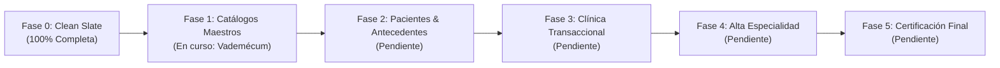

# 📋 Plan de Progreso y Certificación Modular CENDO

> **Proyecto:** CENDO - Centro de Endometriosis y Ginecología  
> **Director Médico:** Dr. Patrick José Jacinto Gomero (CMP 61693 | RNE 38657)  
> **Arquitectura:** Rebanadas Verticales por Dominio (*Vertical Slice / Feature Modules*)  
> **Meta:** Cero archivos gigantes (> 1,000 líneas), código modular aislado (< 120 líneas por archivo), validación anti-duplicados en 3 capas y persistencia 100% en la nube Supabase.

---

## 🧭 Metodología de Trabajo: Enfoque *Bottom-Up*
1. **Catálogos Base** &rarr; 2. **Directorio de Pacientes** &rarr; 3. **Actos Médicos Transaccionales** &rarr; 4. **Alta Especialidad** &rarr; 5. **Exportación y Certificación Multi-Dispositivo**.

Cada módulo contendrá su propio cuarteto estándar:
- `modulo.types.ts`: Tipos TypeScript específicos.
- `modulo.validator.ts`: Esquemas Zod y detección de duplicados previa a la red.
- `modulo.service.ts`: CRUD contra Supabase con manejo seguro de errores.
- `components/`: Modales y vistas del módulo.

---

## 📊 Estado General de Fases y Módulos

---

## 🗂️ Detalle Exhaustivo por Módulos y Checklists

### 🧹 FASE 0: Tabula Rasa & Infraestructura de Sincronización
- [x] Crear script maestro de vaciado `supabase/clean_slate_reset.sql` (`TRUNCATE CASCADE` de las 16 tablas sin tocar `public.profiles`).
- [x] Garantizar persistencia y accesos de los 3 médicos oficiales con clave `Cendo123`.
- [x] Actualizar `fetchAllDataFromSupabase` para soportar estados vacíos (`[]`) sin forzar datos quemados obsoletos.
- [x] Implementar script de certificación automatizada `scripts/test-vademecum-crud.mjs`.
- [x] Ejecutar y validar test automatizado del Vademécum (4/4 pruebas PASS, 100% de éxito).
- [x] Crear script opcional de carga de fármacos ginecológicos oficiales `scripts/seed-vademecum.mjs`.

---

### 📦 FASE 1: Catálogos Maestros (Sin dependencias externas)

#### 💊 Módulo 1: Vademécum Farmacológico (`src/modules/vademecum/`)
- [ ] **Estructura Modular:**
  - [ ] `src/modules/vademecum/vademecum.types.ts`: Tipos dedicados de fármacos, marcas y precios.
  - [ ] `src/modules/vademecum/vademecum.validator.ts`:
    - [ ] Detección preventiva de fármaco duplicado por nombre genérico (insensible a mayúsculas/espacios).
    - [ ] Detección preventiva de colisión de código ATC.
    - [ ] Validación de marcas comerciales con precio de referencia > 0.
  - [ ] `src/modules/vademecum/vademecum.service.ts`:
    - [ ] `getVademecumItems()`: Consulta en vivo de fármacos.
    - [ ] `createVademecumItem()`: Creación con validación y upsert en Supabase.
    - [ ] `updateVademecumItem()`: Edición de marcas, posología e indicaciones.
    - [ ] `deleteVademecumItem()`: Eliminación segura.
- [ ] **Base de Datos (Supabase):**
  - [ ] Índice único case-insensitive en PostgreSQL: `CREATE UNIQUE INDEX IF NOT EXISTS idx_vademecum_unique_name ON public.medications_vademecum (LOWER(TRIM(generic_name)));`
- [ ] **Interfaz Gráfica (`/vademecum`):**
  - [ ] Alerta interactiva amigable en `VademecumModal` si el doctor escribe un nombre que ya existe, invitándolo a editar o agregar una nueva marca comercial.
  - [ ] Empty state visual limpio cuando la tabla está vacía.
- [ ] **Certificación:**
  - [ ] Ejecutar `npm run test:vademecum` y certificar creación, lectura, edición y eliminación.

---

#### 🏷️ Módulo 2: Tarifario Institucional y Procedimientos (`src/modules/tarifario/`)
- [ ] **Estructura Modular:**
  - [ ] `src/modules/tarifario/tarifario.types.ts`: Tipos de tarifas, categorías (Consulta, Ecografía, Procedimiento, Paquete) y precios.
  - [ ] `src/modules/tarifario/tarifario.validator.ts`:
    - [ ] Validación de código único (ej. `PROC-001`).
    - [ ] Detección de nombre de procedimiento duplicado.
    - [ ] Precio obligatorio y mayor a 0 PEN.
  - [ ] `src/modules/tarifario/tarifario.service.ts`:
    - [ ] `getTariffItems()`
    - [ ] `createTariffItem()`
    - [ ] `updateTariffItem()`
    - [ ] `deleteTariffItem()`
- [ ] **Base de Datos (Supabase):**
  - [ ] Garantizar índice único en `procedures_tariff (code)` y `procedures_tariff (LOWER(TRIM(name)))`.
- [ ] **Interfaz Gráfica (`/tarifario`):**
  - [ ] Conexión de `/tarifario` y `TariffModal` al nuevo servicio modular.
  - [ ] Mensaje de prevención de código o procedimiento repetido.
- [ ] **Certificación:**
  - [ ] Script automatizado `scripts/test-tarifario-crud.mjs` (`npm run test:tarifario`).
  - [ ] Prueba visual en web: Crear tarifas de Consulta (S/ 180) y Colposcopía (S/ 350).

---

#### 👨‍⚕️ Módulo 3: Directorio Médico, Roles y Accesos (`src/modules/usuarios/`)
- [ ] **Estructura Modular:**
  - [ ] `src/modules/usuarios/usuarios.types.ts`: Perfil médico, roles (`director`, `doctor`, `assistant`), credenciales CMP/RNE.
  - [ ] `src/modules/usuarios/usuarios.validator.ts`:
    - [ ] Correo institucional único y con formato válido.
    - [ ] CMP de 5 a 6 dígitos numéricos.
    - [ ] Contraseña médica mínima de 6 caracteres.
  - [ ] `src/modules/usuarios/usuarios.service.ts`:
    - [ ] `getDoctors()`: Carga de lista médica de `public.profiles`.
    - [ ] `updateDoctorPassword()`: Actualización directa de contraseña en la nube.
    - [ ] `updateDoctorProfile()`: Edición de CMP, RNE, especialidad y firma.
    - [ ] `toggleDoctorActive()`: Bloqueo/activación de acceso institucional.
- [ ] **Interfaz Gráfica (`/usuarios`):**
  - [ ] Conectar `/usuarios` y `DoctorModal` al servicio modular.
- [ ] **Certificación:**
  - [ ] Prueba de cambio de clave del Dr. Patrick y verificación de reingreso en PC y móvil.

---

### 🏥 FASE 2: Núcleo de Pacientes e Historia Patronímica

#### 👤 Módulo 4: Directorio de Pacientes (`src/modules/pacientes/`)
- [ ] **Estructura Modular:**
  - [ ] `src/modules/pacientes/pacientes.types.ts`: Ficha patronímica del paciente.
  - [ ] `src/modules/pacientes/pacientes.validator.ts`:
    - [ ] Validación de DNI peruano de 8 dígitos numéricos.
    - [ ] Detección preventiva de DNI duplicado antes de enviar.
    - [ ] Cálculo automático de edad según fecha de nacimiento.
  - [ ] `src/modules/pacientes/pacientes.service.ts`:
    - [ ] `getPatients()`
    - [ ] `getPatientById()`
    - [ ] `createPatient()`
    - [ ] `updatePatient()`
    - [ ] `deletePatient()` (con cascada controlada)
- [ ] **Base de Datos (Supabase):**
  - [ ] Garantizar índice único `idx_patients_dni` en `public.patients (dni)`.
- [ ] **Interfaz Gráfica (`/pacientes`):**
  - [ ] Conectar `/pacientes` y `PatientModal` al nuevo servicio modular.
  - [ ] Búsqueda reactiva por DNI o Apellidos.
- [ ] **Certificación:**
  - [ ] Script de prueba automatizado `scripts/test-pacientes-crud.mjs`.

---

#### 📜 Módulo 5: Antecedentes Gineco-Obstétricos (`src/modules/antecedentes/`)
- [ ] **Estructura Modular:**
  - [ ] `src/modules/antecedentes/antecedentes.types.ts`: Menarquia, FUR, R/C (ej. 28/4), Fórmula Obstétrica (G_ P____), ITS, alergias, patologías familiares.
  - [ ] `src/modules/antecedentes/antecedentes.validator.ts`: Formato de fecha FUR y consistencia obstétrica.
  - [ ] `src/modules/antecedentes/antecedentes.service.ts`: Upsert y consulta en `public.patient_backgrounds`.
- [ ] **Interfaz Gráfica:**
  - [ ] `PatientBackgroundModal` conectado al servicio modular.
- [ ] **Certificación:**
  - [ ] Validar guardado y persistencia en Supabase vinculado al UUID del paciente.

---

### 🩺 FASE 3: El Acto Médico Transaccional

#### 📅 Módulo 6: Agenda de Citas Médicas (`src/modules/agenda/`)
- [ ] `agenda.types.ts`, `agenda.validator.ts` (prevención de solapamiento de horario por doctor), `agenda.service.ts`.
- [ ] Conexión de `/agenda` y `AppointmentModal`.
- [ ] Validación de estados: Pendiente, Confirmada, En Espera, Atendida, Cancelada.

#### 🩺 Módulo 7: Consulta Ginecológica Estructurada (`src/modules/consultas/`)
- [ ] `consultas.types.ts`, `consultas.validator.ts` (signos vitales: PA, FC, IMC), `consultas.service.ts`.
- [ ] Registro de motivo de consulta, tiempo de enfermedad, examen físico especuloscópico y CIE-10.
- [ ] Persistencia en `public.medical_consultations`.

#### 💊 Módulo 8: Recetario Médico Inteligente (`src/modules/recetas/`)
- [ ] Integración con el Vademécum de la Fase 1 (autocompletado al escribir).
- [ ] Emisión de receta con posología, instrucciones y sello médico.
- [ ] Generación de PDF oficial e integración con envío por WhatsApp.

#### 🧪 Módulo 9: Órdenes de Laboratorio y Cotizaciones (`src/modules/laboratorio/` & `src/modules/cotizaciones/`)
- [ ] Integración con el Tarifario de la Fase 1.
- [ ] Cálculo de cotizaciones con descuentos y formato WhatsApp para la paciente.
- [ ] Solicitud de exámenes auxiliares (PAP, VPH, CA-125, perfil hormonal).

---

### 🔬 FASE 4: Módulos de Alta Especialidad Ginecológica

#### 🔬 Módulo 10: Colposcopía IFCPC 2011 (`src/modules/colposcopia/`)
- [ ] Mapeo cervical con criterios IFCPC (Unión escamocolumnar, zona de transformación, acetoblanco grado 1 y 2, Schiller).
- [ ] Registro de reloj horario de biopsia cervical (1 a 12 horas).
- [ ] Persistencia en `public.colposcopy_reports`.

#### 📺 Módulo 11: Ecografías Ginecológicas y Obstétricas (`src/modules/ecografias/`)
- [ ] Formatos especializados para Ecografía Transvaginal, Pélvica, Mama Bilateral (BI-RADS 1-5) y Obstétrica.
- [ ] Persistencia en `public.ultrasound_reports`.

#### ✂️ Módulo 12: Procedimientos Menores & Biopsias LEEP (`src/modules/procedimientos/`)
- [ ] Reporte operatorio de cono LEEP, polipectomía, inserción/retiro de DIU o implante Jadelle.
- [ ] Registro de patología, sangrado y hemostasia (Solución de Monsel).
- [ ] Persistencia en `public.minor_procedures`.

#### 👶 Módulo 13: Carnet de Control Prenatal MINSA / CLAP (`src/modules/prenatal/`)
- [ ] Registro de datos basales, cálculo de Naegele / FPP, visitas de control gestacional (1 a 9).
- [ ] Persistencia en `public.prenatal_cards`.

#### 📁 Módulo 14: Repositorio Documental (.pdf & .docx) (`src/modules/documentos/`)
- [ ] Subida a Supabase Storage (bucket `lab-reports`).
- [ ] Registro en `patient_documents` y visualización en modal.

---

### 🚀 FASE 5: Desacoplamiento de la Gran Ficha y Certificación Final
- [ ] **Desacoplar `pacientes/[id]/page.tsx`** (~2,450 líneas) en sub-pestañas autónomas (`TabHistoria`, `TabConsultas`, `TabColposcopia`, `TabEcografias`, `TabRecetas`, etc.).
- [ ] **Aligerar `useMedicalStore.ts`** y eliminar el archivo monolítico `supabaseSync.ts`.
- [ ] Verificación cruzada final en **PC (escritorio)**, **Tablet (iPad/Android)** y **Móvil**.
- [ ] Prueba de aceptación completa con el **Dr. Patrick Jacinto Gomero**.

---

*Última actualización de progreso: 2026-11-14T11:25:00-05:00*
